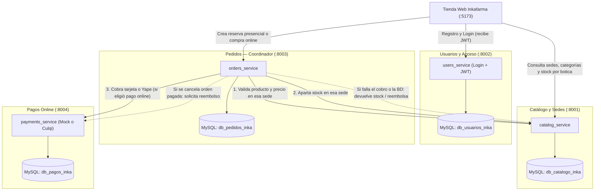

# Guía Comparativa del Sistema vs. Borrador del Word (Informe 3)

**Proyecto:** Plataforma Web Inkafarma — Reserva, Pago Online y Retiro en Botica  
**Última actualización:** 19 de noviembre de 2026  

---

## 1. Funcionalidades Actuales del Sistema

Hoy la aplicación permite simular de forma real todo el proceso de compra o reserva de medicamentos para recoger en una botica de Inkafarma:

1. **Tienda web con apariencia real de Inkafarma:** Muestra la web lista para un cliente final (con los logos oficiales en SVG y sin textos técnicos ni menciones académicas visibles en la pantalla).
2. **Catálogo y stock distinto por cada botica:** El usuario puede cambiar entre **Inkafarma Miraflores**, **Inkafarma San Isidro** e **Inkafarma Lima Centro**. Cada sede muestra solo los productos que realmente tiene y su propio stock; si el carrito tenía productos y se cambia de botica, el carrito se reinicia automáticamente con un aviso para no mezclar inventarios de distintas sedes.
3. **Búsqueda y filtros por categoría:** Barra buscadora en vivo y categorías cargadas directamente desde la base de datos (`Medicamentos y Alivio del Dolor`, `Cuidado Personal y Dermocosmética`, `Vitaminas y Suplementos`).
4. **Registro e inicio de sesión:** El usuario crea una cuenta nueva (su contraseña se guarda cifrada) o inicia sesión. Al entrar, el sistema le entrega un pase de seguridad digital (**token JWT**) que se guarda en su navegador.
5. **Dos formas reales de pagar y recoger en botica:**
   - **Opción A — Pagar en botica al recoger:** El sistema verifica el stock en la botica elegida, aparta (descuenta) las unidades al instante y genera un código único de retiro (ej. `INKA-CC-7F3A9`) con estado **`RESERVED`**. El cliente paga en caja al recoger.
   - **Opción B — Pagar online con Tarjeta o Yape y recoger en botica:** El sistema **primero aparta el stock en la botica** y luego procesa el cobro con tarjeta (`VISA`, `MASTERCARD`, `AMEX`) o `YAPE`. Si se aprueba, emite el código de retiro `INKA-CC-XXXXX` junto con un número de operación (`PAY-INKA-...`) en estado **`PAID`**, listo para recoger sin hacer cola en caja.
6. **Devolución automática de stock y dinero si la compra falla:**
   - Por ejemplo, si un cliente intenta comprar 2 cajas de Paracetamol pagando con tarjeta: primero el sistema aparta esas 2 cajas en la botica; si luego la tarjeta es rechazada por falta de fondos o se cae el servicio de pagos, el sistema **vuelve a sumar automáticamente esas 2 cajas al stock de la botica**.
   - Si el pago con tarjeta sí se aprobó, pero ocurre un error justo al guardar el pedido en la base de datos, el sistema **devuelve las 2 cajas al inventario y también anula/reembolsa el cobro de dinero**, de modo que nunca se pierde stock ni se cobra por un pedido no registrado.
7. **Historial de pedidos y entrega en mostrador:** Desde *"Mis Reservas"* el cliente ve sus códigos, montos, sede y estado (`Listo para Recojo`, `Pagado Online • Listo para Recojo`, `Entregado en Botica` o `Cancelado`). Desde el ticket de confirmación también se puede registrar la entrega en botica (cambia el estado a **`COLLECTED`**).
8. **Cancelación con devolución de stock y reembolso (vía API / Swagger):** Si se cancela un pedido (`PATCH /orders/{id}/cancel`), el sistema devuelve automáticamente las unidades **a la misma botica donde se compró** y, si había sido pagado online, registra el reembolso (**`REFUNDED`**).

### Stock y productos disponibles por botica al iniciar

| Producto | Miraflores (Sede `1`) | San Isidro (Sede `2`) | Lima Centro (Sede `3`) |
| :--- | :---: | :---: | :---: |
| Paracetamol 500mg (`#1`) | `50` un. | `18` un. | `85` un. |
| Ibuprofeno 400mg (`#2`) | `30` un. | `4` un. *(últimas un.)* | `0` un. *(agotado)* |
| Amoxicilina 500mg (`#3`) | `20` un. | *No disponible* | `3` un. *(últimas un.)* |
| Protector Solar FPS 50+ (`#4`) | `15` un. | `28` un. | *No disponible* |
| Vitamina C + Zinc (`#5`) | `40` un. | `22` un. | `16` un. |
| Alcohol Medicinal 70° (`#6`) | *No disponible* | `35` un. | `25` un. |
| Loratadina 10mg (`#7`) | *No disponible* | `14` un. | `19` un. |
| Colágeno Hidrolizado (`#8`) | `12` un. | *No disponible* | *No disponible* |

---

## 2. Módulos del Sistema

El proyecto está dividido en **5 módulos independientes**: un frontend web y **4 servicios backend**, cada uno con su propia base de datos en MySQL.

| Módulo | Puerto / Base de datos | Qué hace y qué controla |
| :--- | :--- | :--- |
| **1. Tienda Web (`frontend`)** | Puerto `:5173`<br>*(React 19 + Vite 8 + Tailwind)* | Interfaz visual del cliente: selector de botica, catálogo dinámico, buscador, login/registro, carrito con elección de pago en caja o pago online (Tarjeta/Yape), ticket de retiro e historial. Archivo principal: [App.jsx](frontend/src/App.jsx). |
| **2. Catálogo y Sedes (`catalog_service`)** | Puerto `:8001`<br>BD: `db_catalogo_inka` | Guarda las categorías (`categories`), las boticas (`branches`), el catálogo maestro (`products`) y el inventario independiente de cada sede (`branch_inventory`). Se encarga de apartar (`block`) o devolver (`release`) stock de forma segura en la sede elegida. Código en [catalog_service/main.py](catalog_service/main.py). |
| **3. Usuarios y Acceso (`users_service`)** | Puerto `:8002`<br>BD: `db_usuarios_inka` | Registra clientes encriptando sus contraseñas (`bcrypt`) y valida credenciales al iniciar sesión. **Aquí es donde actualmente se aplica JWT:** al hacer login (`POST /auth/login`) genera el token de sesión firmado, y en `GET /auth/me` lo valida para devolver el perfil del cliente. Código en [users_service/main.py](users_service/main.py). |
| **4. Pedidos (`orders_service`)** | Puerto `:8003`<br>BD: `db_pedidos_inka` | Recibe la compra o reserva del cliente y coordina los pasos con Catálogo (`:8001`) y Pagos (`:8004`). Guarda la orden, los ítems, la sede (`branch_id`), el código `INKA-CC-XXXXX` y el estado (`RESERVED`, `PAID`, `COLLECTED`, `CANCELLED`). Código en [orders_service/main.py](orders_service/main.py). |
| **5. Pagos Online (`payments_service`)** | Puerto `:8004`<br>BD: `db_pagos_inka` | Procesa los cobros con Tarjeta o Yape y registra los intentos aprobados (`APPROVED`), rechazados (`DECLINED`) y reembolsados (`REFUNDED`) sin guardar nunca el número completo de tarjeta ni el CVV. Funciona con un modo de pruebas local (`mock`) listo para usar sin cuentas externas, y trae listo un adaptador para conectar Culqi Sandbox (`culqi`) cambiando solo el `.env`. Código en [payments_service/main.py](payments_service/main.py) y [providers.py](payments_service/providers.py). |

### Resumen de rutas (endpoints) disponibles hoy

| Servicio | Rutas principales |
| :--- | :--- |
| **Catálogo (:8001)** | `GET /branches/`, `POST /branches/`, `GET /branches/{id}/products`, `PUT /branches/{id}/inventory/{product_id}`, `GET /categories/`, `POST /categories/`, `GET /products/?branch_id=`, `GET /products/{id}?branch_id=`, `POST /products/`, `PATCH /products/{id}/stock` |
| **Usuarios (:8002)** | `POST /auth/register`, `POST /auth/login` *(emite JWT)*, `GET /auth/me` *(valida JWT)*, `GET /users/{id}` |
| **Pedidos (:8003)** | `POST /orders/`, `GET /orders/`, `GET /orders/{id}`, `GET /orders/user/{user_id}`, `PATCH /orders/{id}/collect`, `PATCH /orders/{id}/cancel` |
| **Pagos (:8004)** | `GET /payments/config`, `POST /payments/charge`, `GET /payments/{id}`, `GET /payments/user/{user_id}`, `POST /payments/{id}/refund` |

---

## 3. Arquitectura Actual

El sistema sigue una arquitectura orientada a servicios donde **cada módulo tiene su propia base de datos aislada** (*Database-per-Service*). Ningún servicio entra directo a las tablas de otro: toda comunicación se hace por peticiones HTTP/REST.



### Cómo cuida el sistema que no haya errores de stock ni cobros dobles

1. **Si dos clientes intentan llevarse la última unidad en la misma botica:** Cuando `catalog_service` va a descontar stock de una sede, bloquea temporalmente esa fila de `branch_inventory` en MySQL (`SELECT ... FOR UPDATE`) hasta terminar la operación. Así solo uno logra apartarla y el segundo recibe aviso de stock insuficiente.
2. **Devolución automática de stock y dinero si falla algún paso de la compra:** Como cada servicio tiene su propia base de datos, no basta con deshacer una sola tabla en SQL. Por eso `orders_service` ejecuta cada compra en orden seguro y deshace automáticamente los pasos anteriores si algo falla (por ejemplo, si ya apartó 2 cajas de Paracetamol en una botica y luego la tarjeta es rechazada, vuelve a sumar esas 2 cajas a esa misma botica; y si fallara el guardado final después de haber cobrado, devuelve tanto las 2 cajas como el dinero cobrado):
   - **Paso 1:** Consulta precio y existencia en la botica seleccionada (`:8001`).
   - **Paso 2:** Aparta las unidades en esa botica (`:8001`). Si el producto 1 se apartó pero el producto 2 no tiene stock, automáticamente devuelve las unidades del producto 1.
   - **Paso 3 (solo si eligió pago online):** Envía el cobro a Pagos (`:8004`). **Si la tarjeta es rechazada o Pagos está apagado, `orders_service` devuelve automáticamente a la botica las unidades que apartó en el Paso 2.**
   - **Paso 4:** Guarda el pedido en `db_pedidos_inka`. Si ocurriera un error de base de datos justo al guardar, devuelve las unidades a Catálogo (`:8001`) y, si ya se había cobrado online, solicita el reembolso en Pagos (`:8004`).

---

## 4. Observaciones al Comparar el Sistema Actual con el Borrador del Word (Informe 3)

El borrador actual del Word/PDF fue redactado mirando una **versión antigua del proyecto** (antes de implementar el descuento real de stock, el inventario independiente por botica y el servicio de pagos online), y además en la sección 2.2 todavía dice *"Objetivo del avance 2"*.

Si se entrega ese Word sin actualizar, **va a contradecir lo que hace el programa al momento de demostrarlo**. Abajo está el detalle sección por sección de qué corregir o agregar:

| Sección del Word | Qué dice el Word hoy | Qué hace realmente el sistema ahora | Qué corregir o agregar en el Word |
| :--- | :--- | :--- | :--- |
| **Cap. 1 (1.1–1.6)** | Historia, misión, visión, valores, FODA y estrategia de Inkafarma. | Coincide bien con la tienda. | **Mantener tal cual.** |
| **1.7 Lienzo** (pág. 5) | Dice título *"Lienzo Lean Canvas"*, pero los recuadros son de *Business Model Canvas* (*Socios clave, Actividades clave, Recursos clave...*) y dice que falta inventario por sede. | Error de nombre del lienzo; además el inventario por sede **ya funciona**. | Cambiar título a **Business Model Canvas** (o rehacer el gráfico como Lean Canvas). Actualizar "Recursos clave" indicando que ya existen los **4 servicios** y el inventario por sede. |
| **2.1 Proceso AS IS** (págs. 5–6) | Muestra el problema tradicional de cobrar online antes de revisar si hay stock en botica. | Sigue sirviendo para justificar por qué ahora se aparta stock antes de cobrar. | **Mantener** como situación inicial del problema. |
| **2.2 Problemática y objetivo** (pág. 6) | Dice *"Objetivo del avance 2"* y que el sistema *"no aparta ni descuenta unidades, no permite elegir botica y sale como compra COMPLETED"*. | **Ya está desactualizado.** Hoy sí descuenta stock por botica, sí deja elegir sede y crea pedidos `RESERVED` (pago en caja) o `PAID` (pago online). | Cambiar a **Avance 3**. Explicar que esa problemática era de la versión inicial y que ahora el sistema ya cubre ambas formas de pago con stock por botica. |
| **2.3 Alcance funcional** (págs. 6–7) | Dice *"aún no se ha integrado inventario por sede, pago en caja ni entrega física"*. | Todo eso **ya está integrado** (sedes independientes, pago online en `:8004`, simulación de entrega `COLLECTED`). | Actualizar el alcance mencionando las 2 modalidades de pago y el stock por botica. Aclarar como límite real que el cobro usa simulador local (`mock`) con soporte para Culqi Sandbox, sin POS físico ni vencimiento automático por hora. |
| **2.4 y 2.5 TO BE y Comparación** (pág. 7) | Solo describe pago presencial en caja y habla de devolución de stock por cancelación o vencimiento. | Soporta **pago presencial** y **pago online con apartado previo de stock**; la devolución funciona al **cancelar** o **rechazar un pago**, no por vencimiento automático de horas. | Agregar en el TO BE el flujo de pago online seguro (apartar stock → cobrar → emitir orden `PAID` o devolver stock si rechaza) y aclarar que el vencimiento automático por reloj queda pendiente. |
| **3.1 Arquitectura** (pág. 8) | Solo menciona 3 APIs (`8001`–`8003`) y 3 bases de datos. | Son **4 servicios** (`8001`–`8004`), **4 bases de datos** (`db_pagos_inka` nueva) y tablas `branches`/`branch_inventory`. | Actualizar el diagrama y la tabla incluyendo `payments_service (:8004)` y las tablas de sedes. |
| **3.2 Servicios y estados** (págs. 8–9) | Habla en futuro (*"Catálogo debe..."*) y usa estados en español (`SOLICITADA`, `RESERVADA`, `ENTREGADA`). | Todo eso ya está hecho y los estados reales del código están en inglés: `RESERVED`, `PAID`, `COLLECTED`, `CANCELLED` (y en pagos `APPROVED`, `DECLINED`, `REFUNDED`). | Redactar en presente describiendo los 4 servicios y colocar los **estados reales en inglés** para que coincidan con el sistema y la base de datos. |
| **3.3 Contratos REST** (pág. 9) | Lista 7 rutas viejas y propone rutas en español (`/reservas`, `/inventario/reservas`) que **no existen**. | Hay más de 20 rutas reales en `:8001`–`:8004` (listadas en la Sección 2 de este documento). | Reemplazar esa tabla por los endpoints reales que muestra Swagger (`/docs` de cada puerto). |
| **3.4 Seguridad** (pág. 9) | Dice que Pedidos aún no valida el JWT de Usuarios. | **Sigue siendo verdad** (ver detalle en la Sección 5). | **Mantener la observación** aclarando que JWT **sí se usa en el login y perfil (`:8002`)**, pero todavía falta validarlo dentro de Pedidos (`:8003`). Agregar que Pagos no guarda tarjetas completas ni CVV. |
| **3.5 Consistencia y fallos** (págs. 9–10) | Propone bloqueo transaccional, devolución de stock si falla algo y clave contra duplicados. | El bloqueo por fila en cada sede y la devolución automática de stock/dinero si falla el pago o la BD **ya están funcionando**. Falta la clave contra envíos repetidos (`Idempotency-Key`) y trazas. | Separar claramente lo que **ya funciona** (bloqueo por fila en BD + devolución automática de stock y dinero si falla el pago o el guardado) de lo que **queda pendiente** (`Idempotency-Key` y trazas). |
| **4.1 Estado comprobado** (pág. 10) | Dice que Paracetamol tenía 50 y quedó en 50, estado `COMPLETED` y *"Total Pagado"*. | **Totalmente falso frente al sistema actual.** | **Rehacer completo con capturas reales actuales:** cambio de stock por sede, reserva `RESERVED`, pago online `PAID`, rechazo `402` devolviendo stock, entrega `COLLECTED` y cancelación con reembolso. |
| **4.2 Pruebas** (pág. 10) | Pone 5 pruebas como trabajo futuro. | Casi todas **ya se pueden ejecutar hoy** (stock por sede, concurrencia en BD, cancelación con reembolso, pago rechazado con devolución de stock, servicio caído `503` y entrega `COLLECTED`). Solo faltan vencimiento por tiempo e idempotencia. | Cambiar a tabla de **Pruebas Ejecutadas vs. Pendientes** mostrando resultados reales. |
| **4.3 Indicadores** (pág. 10) | Propone KPIs e hipótesis del 70 %. | Planteamiento metodológico correcto. | **Mantener tal cual.** |

---

## 5. Qué Todavía NO Está Implementado (No Ponerlo como Hecho en el Word)

1. **Validación del token JWT fuera del login:**
   - **Qué sí funciona:** `users_service` (`:8002`) crea el token JWT al iniciar sesión (`POST /auth/login`) y sí lo verifica al consultar el perfil (`GET /auth/me`); además el frontend lo guarda y lo envía en la cabecera `Authorization`.
   - **Qué falta:** `orders_service` (`:8003`) y `payments_service` (`:8004`) **todavía no verifican ese token** y aceptan el `user_id` que llegue en el JSON. Si alguien llama directo a `:8003/orders/` por Swagger o Postman sin token, la petición pasa igual.
2. **Vencimiento automático por horas:** No existe fecha/hora límite (`expires_at`) en las órdenes ni un proceso automático que libere el stock si el cliente no recoge su pedido después de X horas.
3. **Protección contra doble envío por red lenta (`Idempotency-Key`):** Si se envía exactamente la misma petición de creación de orden dos veces seguidas fuera de la pantalla normal, el backend crea dos pedidos y descuenta stock dos veces.
4. **Entrega buscando por código de retiro y botón de cancelar en la web:**
   - La entrega (`PATCH /orders/{id}/collect`) ya bloquea órdenes canceladas, pero busca la orden por su `id` numérico y no validando el texto del código `INKA-CC-XXXXX`.
   - La cancelación (`PATCH /orders/{id}/cancel`) funciona perfecto por Swagger/API (devuelve stock a la botica y reembolsa el pago), pero todavía no tiene un botón dentro de *"Mis Reservas"* en la web.
5. **Notificaciones y seguimiento de logs:** No se envían correos, SMS ni mensajes de WhatsApp, ni existe un código único de rastreo en logs entre los 4 servicios.

---

## 6. Cómo Levantar el Sistema y Qué Evidencias Tomar para el Word

### 6.1 Levantar todo en local

1. **Bases de datos y datos iniciales en MySQL:**
   ```powershell
   mysql -u root -p < init_db.sql
   mysql -u root -p < seed_data.sql
   ```
   *(Verificar que los 4 archivos `.env` —`catalog_service/.env`, `users_service/.env`, `orders_service/.env`, `payments_service/.env`— tengan la contraseña de MySQL tanto en `DB_PASSWORD` como en `DATABASE_URL`).*
2. **Iniciar los 4 servicios backend + la web:**
   ```powershell
   .\run_all.ps1
   ```
   *(O `.\run_all.bat`).* Abrir `http://localhost:5173`.
3. **Acceso de usuario para pruebas:** El usuario incluido en `seed_data.sql` tiene un hash de referencia; para iniciar sesión en las pruebas, registrarse desde la pestaña **"Registrarme"** (o hacer clic en *"Usar cuenta de prueba para demostración"* dentro de **"Registrarme"** la primera vez).

### 6.2 Tarjetas y códigos Yape para probar pagos online (`PAYMENT_PROVIDER=mock`)

| Prueba | Medio | Qué ingresar | Qué ocurre en el sistema |
| :--- | :--- | :--- | :--- |
| **Pago exitoso** | Tarjeta | `4242 4242 4242 4242`, mes `12`, año `2028`, CVV `123` | Cobro aprobado, descuenta stock de la botica y crea orden **`PAID`** (`PAY-INKA-...`). |
| **Sin fondos (devolución automática de stock)** | Tarjeta | Terminada en `0002` (ej. `4000 0000 0000 0002`) | Error `402` (*"Fondos insuficientes"*); **devuelve automáticamente el stock** a la botica. |
| **Banco / vencida** | Tarjeta | Terminada en `0069` o `9995` | Error `402` y **devuelve automáticamente el stock** a la botica. |
| **Yape exitoso** | Yape | Celular `999888777` + código `123456` (cualquiera distinto de `000000`) | Cobro aprobado y orden **`PAID`**. |
| **Yape inválido (devolución automática de stock)** | Yape | Celular `999888777` + código `000000` | Error `402` y **devuelve automáticamente el stock** a la botica. |

### 6.3 Capturas concretas recomendadas para actualizar el Word (Secciones 4.1 y 4.2)

1. **Stock distinto por sede:** Pantalla comparando *Miraflores* (Paracetamol `50`, Amoxicilina `20`) vs. *San Isidro* (Paracetamol `18`, Ibuprofeno `4`, Alcohol Medicinal `35`).
2. **Reserva para pago en botica (`RESERVED`):** Ticket mostrando código `INKA-CC-XXXXX`, *"Total a Pagar en Botica"* y el descuento de stock reflejado solo en esa sede.
3. **Pago online aprobado (`PAID`):** Formulario de Tarjeta o Yape + ticket *"¡Pago Aprobado y Pedido Listo!"* con número de operación `PAY-INKA-...` y fila guardada en `db_pagos_inka.payments`.
4. **Devolución automática de stock si el pago es rechazado (`HTTP 402`):** Intento con tarjeta `...0002` (o Yape `000000`) mostrando el mensaje de rechazo en el carrito y comprobando que el stock de la botica no bajó.
5. **Entrega y Cancelación:** Confirmar retiro en botica (`COLLECTED`) desde el modal, y cancelar una orden pagada desde `:8003/docs` (`PATCH /orders/{id}/cancel`) mostrando que el stock vuelve a la sede y el pago queda `REFUNDED` en `:8004/docs`.
6. **Caída controlada (`HTTP 503`):** Apagar el servicio de Catálogo (`:8001`) o Pagos (`:8004`) al intentar comprar y mostrar el manejo controlado de error sin corromper inventario.
