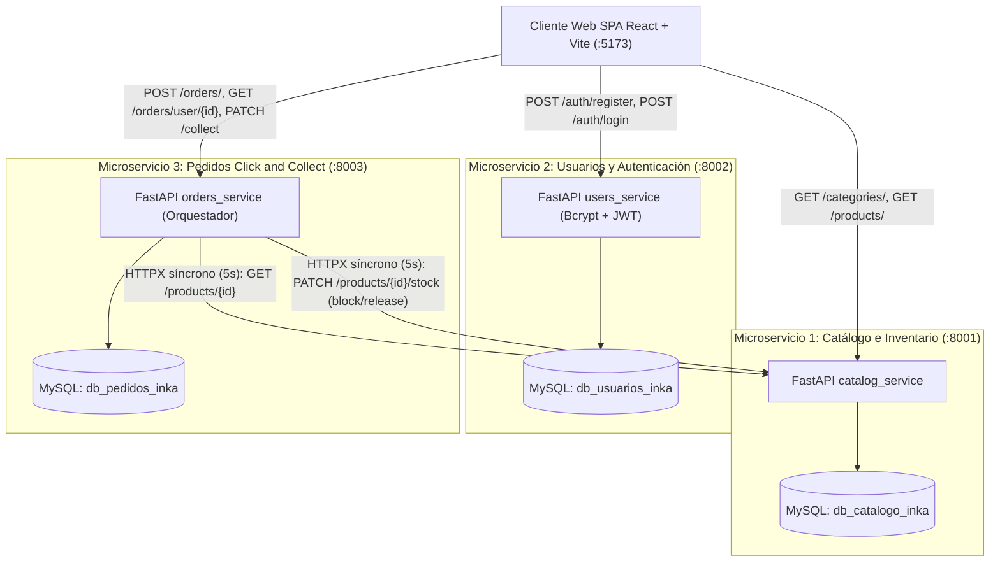

# Informe Comparativo para el Equipo: Estado Real del Sistema vs. Borrador del Word (Informe 3)

**Proyecto:** Plataforma Omnicanal Click & Collect — Inkafarma (UTP — Arquitectura Orientada al Servicio)  
**Fecha de revisión:** 19 de noviembre de 2026  
**Propósito:** Alinear al equipo sobre qué ya está construido y funciona en el repositorio actual, qué secciones del documento Word deben corregirse o actualizarse antes de entregar el **Informe 3**, y qué brechas técnicas siguen pendientes en el código para no afirmarlas como implementadas.

---

## Resumen Ejecutivo para el Equipo

El borrador actual del Word/PDF fue redactado tomando como referencia una **versión inicial del repositorio** (commits del 15 de octubre hasta `46bdab0`), **antes** de la implementación del flujo Click & Collect realizada en el commit `370fa6c` (17 de octubre). Además, la sección 2.2 todavía conserva el texto *"Objetivo del avance 2"*.

> [!IMPORTANT]
> **Tres puntos clave antes de entregar el Informe 3:**
> 1. **El código actual ya supera ampliamente lo que dice el Word:** hoy sí descuenta stock con bloqueo atómico, sí permite elegir botica en el frontend, sí emite código de recojo `INKA-CC-XXXXX` en estado `RESERVED`, sí tiene rollback compensatorio y sí permite simular cobro/entrega (`COLLECTED`) y cancelación (`CANCELLED`).
> 2. **Si el Word se entrega tal como está, contradice al sistema:** el capítulo 2 y la sección 4.1 afirman que el sistema *"no aparta ni descuenta unidades"*, que *"mantuvo 50 unidades de Paracetamol"* y que *"muestra estado COMPLETED y Total Pagado"*, lo cual ya no es cierto al ejecutar la aplicación actual.
> 3. **Aún quedan brechas reales en el código:** no existe inventario independiente por botica en la base de datos, `orders_service` todavía no valida el token JWT, no hay expiración automática (`expires_at`) ni clave de idempotencia (`Idempotency-Key`). **No deben presentarse como terminadas en el informe ni en la exposición** si no se implementan antes.

---

## Parte 1: Qué tiene actualmente el sistema y qué se puede hacer/demostrar hoy

### 1.1 Arquitectura actual implementada

La plataforma implementa el patrón **Database-per-Service** con 3 microservicios FastAPI independientes conectados a esquemas MySQL separados y un cliente web SPA en React:

### 1.2 Stack tecnológico y responsabilidad real por componente

| Componente | Tecnología real en repositorio | Puerto / BD | Responsabilidad actual verificada |
| :--- | :--- | :--- | :--- |
| **Frontend Web** | React (`^19.2.8`), Vite (`^8.3.0`), Tailwind CSS (`^3.4.17`), Lucide Icons | `:5173` | Catálogo con búsqueda y categorías, monitor de salud de los 3 puertos, selector de 3 boticas, modal de login/registro, carrito lateral, ticket `INKA-CC-XXXXX`, simulación de entrega en botica y modal *"Mis Reservas"*. |
| **Catálogo e Inventario** | FastAPI `0.115.0`, SQLAlchemy `2.0.35`, PyMySQL, Alembic | `:8001` / `db_catalogo_inka` | CRUD de categorías y productos, consulta paginada y **bloqueo/liberación atómica de stock** mediante bloqueo pesimista de fila `with_for_update()` (`SELECT ... FOR UPDATE`) en [catalog_service/main.py](catalog_service/main.py#L205-L270). |
| **Usuarios y Seguridad** | FastAPI, `bcrypt==4.2.0` (12 rounds), `pyjwt==2.9.0` (`HS256`) | `:8002` / `db_usuarios_inka` | Registro de clientes, login con emisión de token JWT (expiración por defecto: 60 min), decodificación de perfil en `GET /auth/me` y consulta por ID en [users_service/main.py](users_service/main.py#L62-L221). |
| **Pedidos (Orquestador)** | FastAPI, `httpx==0.27.2` (timeout `5.0 s`) | `:8003` / `db_pedidos_inka` | Orquesta reservas Click & Collect en 3 fases: validación de precio/existencia en `:8001`, bloqueo atómico de stock con **rollback compensatorio** si falla algún ítem, persistencia en estado `RESERVED` con código `INKA-CC-XXXXX` y modalidad `PAGO_EN_CAJA_PRESENCIAL`, además de endpoints `/collect` y `/cancel` ([orders_service/main.py](orders_service/main.py#L71-L297)). |

### 1.3 Qué se puede hacer y demostrar hoy en vivo

El equipo puede ejecutar el sistema (`.\run_all.bat` o `.\run_all.ps1` tras crear las BD con [init_db.sql](init_db.sql) y poblar con [seed_data.sql](seed_data.sql)) y demostrar los siguientes flujos reales:

1. **Monitor de disponibilidad en tiempo real:** En la barra superior ([Navbar.jsx](frontend/src/components/Navbar.jsx#L16-L42)), el frontend consulta cada 25 segundos el estado de `:8001`, `:8002` y `:8003` mostrando *"En línea"* o *"Reconectando..."*.
2. **Catálogo con filtros, búsqueda y stock dinámico:** Muestra las 3 categorías y los 5 productos semilla con etiquetas dinámicas en [ProductCard.jsx](frontend/src/components/ProductCard.jsx#L50-L63): *"Stock en Botica (N)"*, *"Últimas X un. en botica"* (`<= 5`) o *"Agotado en Botica"*.
3. **Selección de botica de recojo:** En el banner principal y dentro del carrito ([App.jsx](frontend/src/App.jsx#L31-L35) y [CartDrawer.jsx](frontend/src/components/CartDrawer.jsx#L138-L163)), el usuario elige entre 3 sedes: *Inkafarma Miraflores (Av. Larco 450)*, *Inkafarma San Isidro (Av. Javier Prado 1200)* e *Inkafarma Lima Centro (Jr. de la Unión 600)*.
4. **Registro e inicio de sesión con JWT:** El modal de autenticación ([AuthModal.jsx](frontend/src/components/AuthModal.jsx)) registra usuarios nuevos (contraseña hasheada con bcrypt) o inicia sesión devolviendo un Bearer Token JWT que se guarda en `localStorage`.
5. **Reserva Click & Collect con descuento real de stock:** Al confirmar en el carrito:
   - `orders_service` valida precio y existencia contra `catalog_service`.
   - `orders_service` bloquea las unidades en `db_catalogo_inka` mediante `PATCH /products/{id}/stock` (`action: "block"`).
   - Se registra la orden con estado `RESERVED`, código alfanumérico `INKA-CC-XXXXX` y `payment_method = "PAGO_EN_CAJA_PRESENCIAL"`.
   - El modal de éxito ([OrderSuccessModal.jsx](frontend/src/components/OrderSuccessModal.jsx)) muestra el código copiable, la botica elegida, **"Total a Pagar en Botica"** y recarga el catálogo reflejando el stock reducido inmediatamente.
6. **Entrega y pago presencial en mostrador:** Desde el modal de éxito, el botón **"Simular Entrega y Pago en Botica"** invoca `PATCH /orders/{id}/collect`, cambiando la orden de `RESERVED` a `COLLECTED` (*"Entregado y Pagado en Botica"*).
7. **Consulta de historial ("Mis Reservas"):** El cliente autenticado puede abrir *"Mis Reservas"* en la barra superior para consultar sus tickets y estados (`GET /orders/user/{user_id}`).
8. **Cancelación con reposición automática (vía Swagger/API):** Invocando `PATCH /orders/{id}/cancel` en `:8003/docs`, la orden pasa a `CANCELLED` y devuelve automáticamente las unidades bloqueadas a `:8001` (`action: "release"`).
9. **Pruebas de fallos y resiliencia demostrables hoy:**
   - **Stock insuficiente (`HTTP 400`):** Al intentar reservar más unidades de las disponibles (ej. vía Swagger o forzando cantidad superior al stock), `:8001` rechaza el bloqueo y `:8003` responde `HTTP 400`.
   - **Rollback compensatorio entre múltiples ítems:** Si el Producto A del carrito tiene stock y se bloquea, pero el Producto B falla en la misma orden, `orders_service` ejecuta `release_stock` sobre el Producto A para no dejar inventario congelado ([orders_service/main.py](orders_service/main.py#L126-L139)).
   - **Caída de Catálogo (`HTTP 503`):** Si se detiene el puerto `8001`, `orders_service` captura el error de conexión HTTPX y responde `HTTP 503 Service Unavailable`.

### 1.4 Inventario exacto de Contratos REST y Estados implementados

| Servicio | Método y Ruta real | Alias compatible (oculto en Swagger) | Qué hace actualmente |
| :--- | :--- | :--- | :--- |
| **Catálogo (:8001)** | `GET /` | — | Health check (`status: "online"`) |
| Catálogo (:8001) | `GET /categories/` · `POST /categories/` | — | Listar y crear categorías |
| Catálogo (:8001) | `GET /products/` | `GET /api/v1/products` | Listado paginado (`skip`, `limit`, `category_id`) |
| Catálogo (:8001) | `GET /products/{product_id}` | `GET /api/v1/products/{product_id}` | Detalle, precio y stock del producto |
| Catálogo (:8001) | `POST /products/` | — | Crear nuevo producto |
| Catálogo (:8001) | `PATCH /products/{product_id}/stock` | `PATCH /api/v1/products/{product_id}/stock` | Bloqueo (`block`) o liberación (`release`) atómico con `with_for_update()` |
| **Usuarios (:8002)** | `GET /` | — | Health check (`status: "online"`) |
| Usuarios (:8002) | `POST /auth/register` | `POST /api/v1/auth/register` | Registro con hash bcrypt |
| Usuarios (:8002) | `POST /auth/login` | `POST /api/v1/auth/login` | Login y emisión de JWT (`HS256`) |
| Usuarios (:8002) | `GET /auth/me` | `GET /api/v1/auth/me` | Valida JWT Bearer y retorna perfil del usuario |
| Usuarios (:8002) | `GET /users/{user_id}` | — | Consulta de usuario por ID |
| **Pedidos (:8003)** | `GET /` | — | Health check (`status: "online"`) |
| Pedidos (:8003) | `POST /orders/` | `POST /api/v1/orders` | Crea reserva `RESERVED`, asigna `INKA-CC-XXXXX`, bloquea stock y compensa si falla |
| Pedidos (:8003) | `GET /orders/{order_id}` | `GET /api/v1/orders/{order_id}` | Consulta ticket por ID |
| Pedidos (:8003) | `GET /orders/user/{user_id}` | `GET /api/v1/orders/user/{user_id}` | Historial de reservas de un usuario |
| Pedidos (:8003) | `GET /orders/` | — | Listado global de órdenes |
| Pedidos (:8003) | `PATCH /orders/{order_id}/collect` | — | Marca cobro presencial y entrega (`COLLECTED`) |
| Pedidos (:8003) | `PATCH /orders/{order_id}/cancel` | — | Cancela orden (`CANCELLED`) y devuelve stock a `:8001` |

**Estados reales definidos en** [orders_service/models.py](orders_service/models.py#L11-L25): `RESERVED`, `COLLECTED`, `CANCELLED` (y `PENDING`, `COMPLETED` solo por compatibilidad histórica con la migración inicial).

---

## Parte 2: Comparativa sección por sección — Qué corregir o agregar en el Word (Informe 3)

| Sección del Word | Qué dice actualmente en el PDF | Realidad en el proyecto hoy | Diagnóstico | Qué corregir o agregar en el Word |
| :--- | :--- | :--- | :--- | :--- |
| **Carátula y Cap. 1 (1.1–1.6)** | Reseña, misión, visión, valores, FODA, estrategia y táctica de Inkafarma. | Totalmente alineado con la temática del sistema. | **OK (mantener)** | Conservar tal cual; solo revisar numeración si se ajusta el resto. |
| **1.7 Lienzo Lean Canvas** (pág. 5) | Titulado *"Lienzo Lean Canvas"*, pero muestra bloques de Business Model Canvas (*Socios clave, Actividades clave, Recursos clave...*). | Error metodológico en el documento; además menciona que no hay expiración ni integración por sede (lo cual sigue siendo cierto). | **Corregir forma y detalle** | Cambiar el título a **Business Model Canvas** (o reemplazar la imagen por un Lean Canvas real: Problema, Solución, Métricas clave, Ventaja injusta). Actualizar "Recursos clave" indicando que las APIs de reserva y liberación de stock ya existen, y dejar como pendiente el inventario por sede y la expiración automática. |
| **2.1 Proceso AS IS** (págs. 5–6) | Flujo BPMN de compra web con pasarela online y verificación física posterior. | Sirve como línea base histórica del problema antes del rediseño Click & Collect. | **OK (mantener)** | Mantener como línea base del rediseño. |
| **2.2 Problemática y objetivo** (pág. 6) | Dice *"El prototipo actual no aparta ni descuenta... tampoco permite elegir botica... aparece como compra completada"* y *"Objetivo del avance 2"*. | **Obsoleto.** Todo eso correspondía al estado del 15 de octubre y ya fue resuelto el 17 de octubre. | **Corregir urgente** | Cambiar *"Objetivo del avance 2"* a **Avance 3**. Redactar la problemática inicial en pasado (*"En la primera versión del prototipo..."*) y precisar qué problemas ya resolvió el **Avance 3** vs. qué mejoras quedan para cierre final (stock por sede, JWT en Pedidos, vigencia/expiración e idempotencia). |
| **2.3 Alcance funcional** (págs. 6–7) | Indica *"Límite del prototipo: aún no se ha integrado inventario por sede, pago en caja ni entrega física."* | La simulación de cobro/entrega en mostrador (`PATCH /orders/{id}/collect`) ya existe en API y UI; sigue faltando inventario real separado por sede y pago con pasarela/POS real. | **Actualizar** | Distinguir claramente: la simulación de liquidación en caja y entrega (`COLLECTED`) ya está implementada en el prototipo; el límite real actual es que el stock en `db_catalogo_inka` sigue siendo único/global (no por sucursal) y no existe integración con POS físico ni expiración automática. |
| **2.4 y 2.5 TO BE y Comparación** (pág. 7) | Pasos 1–6 del flujo TO BE con vigencia de reserva y liberación por vencimiento o cancelación. | Los pasos 1–5 y la cancelación ya funcionan; el paso 6 **solo funciona para cancelación manual** (`PATCH /orders/{id}/cancel`), no para vencimiento automático. | **Aclarar alcance** | Mantener la tabla TO BE y precisar en el texto cuáles pasos ya corren en el prototipo actual y que el vencimiento automático por tiempo queda como pendiente/siguiente incremento. |
| **3.1 Arquitectura comprobable** (pág. 8) | React/Vite + 3 FastAPI (`8001`, `8002`, `8003`) + MySQL independiente. Omite que Pedidos ya también modifica stock en Catálogo. | Stack correcto (React 19 + Vite 8 + Tailwind v3), pero ahora Pedidos también llama `PATCH /products/{id}/stock` (`block`/`release`) además de `GET /products/{id}`. | **Actualizar tabla y texto** | Agregar la tabla de comunicación inter-servicio real (incluyendo bloqueo y compensación Saga ligera) y actualizar el diagrama de arquitectura para reflejar el flujo actual. |
| **3.2 Servicios y cambios** (págs. 8–9) | Habla en futuro (*"Catálogo debe...", "Inventario debe..."*) y usa estados en español (`SOLICITADA`, `RESERVADA`, `LISTA_PARA_RECOJO`, `ENTREGADA`, `CANCELADA`, `VENCIDA`). | Ya implementado dentro de `catalog_service` y `orders_service` usando estados en inglés (`RESERVED`, `COLLECTED`, `CANCELLED`). No hay un 4.º servicio separado de Inventario ni servicio de Notificaciones. | **Corregir y alinear** | Aclarar que el módulo de inventario atómico vive dentro de **Catálogo (`:8001`)** (no es un 4.º microservicio). Actualizar los nombres de estado a los reales del código (`RESERVED`, `COLLECTED`, `CANCELLED`) e indicar que `EXPIRED` (`VENCIDA`) y Notificaciones quedan como extensión futura. |
| **3.3 Contratos REST** (pág. 9) | Lista solo 7 rutas viejas y propone 6 rutas en español (`/reservas`, `/inventario/reservas`) que **no existen** en el código. | Existen 17 rutas reales en inglés (ver tabla en la Parte 1.4), incluyendo `PATCH /products/{id}/stock`, `GET /auth/me`, `GET /users/{id}`, `GET /orders/user/{id}`, `PATCH /orders/{id}/collect` y `PATCH /orders/{id}/cancel`. | **Corregir urgente** | Reemplazar la tabla por las **rutas reales actuales** (exactamente como aparecen en Swagger `:8001/docs`, `:8002/docs`, `:8003/docs`). Si quieren proponer rutas nuevas (ej. `POST /orders/{id}/expire` o tabla de stock por sede), etiquetarlas claramente como **Contratos propuestos para trabajo futuro**. |
| **3.4 Seguridad e integración** (pág. 9) | Dice que Pedidos aún no valida el JWT de Usuarios y que HTTPX usa timeout de 5 s. | **Sigue siendo cierto:** `orders_service` aún no valida el Bearer JWT aunque el frontend sí lo envía; `httpx` sí tiene `timeout = 5.0 s`. | **Mantener y precisar** | Conservar esta observación porque sigue vigente. Agregar que `users_service` ya implementa `GET /auth/me` con verificación JWT (`HS256`) y que queda pendiente replicar esa dependencia en `orders_service`. |
| **3.5 Consistencia y fallos** (págs. 9–10) | Plantea como propuesta: transacción atómica para concurrencia, clave de idempotencia, compensación si falla la orden y trazas. | El **bloqueo pesimista transaccional (`with_for_update()`)** y la **compensación automática (`release_stock`)** ante fallo de bloqueo **ya están implementados**. Falta idempotencia, compensación si falla `db.commit()` y trazas (`request_id`). | **Separar "Hecho" vs. "Pendiente"** | No redactarlo todo como si no existiera: documentar `SELECT ... FOR UPDATE` y el rollback compensatorio en `create_order()` como **controles ya implementados**, y dejar `Idempotency-Key`, trazas y expiración como **controles pendientes**. |
| **4.1 Estado comprobado** (pág. 10) | Dice que Paracetamol tenía 50 y mantuvo 50, estado `COMPLETED`, y UI mostró *"Total Pagado"* y *"plazo de entrega"*. | **Totalmente falso respecto al sistema actual.** Hoy sí descuenta de `50` a `49` (o `48`), crea `RESERVED` con `INKA-CC-XXXXX` y muestra *"Total a Pagar en Botica"*. | **Reemplazar completo (CRÍTICO)** | Rehacer toda la sección 4.1 con pruebas y capturas tomadas del sistema actual (ver checklist en Parte 4). |
| **4.2 Pruebas** (pág. 10) | Llama *"Pruebas del avance siguiente"* a los 5 casos (concurrencia, cancelación/vencimiento, reintento, servicio caído, entrega en botica). | 3.5 de los 5 casos **ya se pueden probar hoy** (stock insuficiente/concurrencia en DB, cancelación manual, `:8001` apagado `503` y entrega en botica `COLLECTED`). Quedan pendientes: vencimiento automático e idempotencia ante reintento. | **Convertir a matriz de pruebas** | Presentar una tabla de **Casos de Prueba Ejecutados (Avance 3)** con evidencia real (Aprobado / Pendiente), separando lo ya probado de lo que requiere desarrollo adicional. |
| **4.3 Indicadores** (pág. 10) | Propone KPIs (% retiradas, cancelaciones, vencidas, tiempo en caja) y señala la hipótesis del 70 % sin medición real. | No hay módulo de analítica/métricas en el código; el enfoque metodológico del documento es muy bueno. | **OK (mantener)** | Mantener como indicadores propuestos. Si se desea, agregar el `count` de órdenes por estado desde `db_pedidos_inka` como línea base inicial de prueba. |

---

## Parte 3: Brechas reales que AÚN NO están implementadas en el código

Para evitar observaciones del docente durante la revisión o sustentación, el equipo debe tener claro qué **no** existe todavía en el código actual:

1. **Inventario independiente por botica/sede:**
   - En [catalog_service/models.py](catalog_service/models.py#L48-L52), la tabla `products` tiene una sola columna `stock` y una columna texto `branch` (valor por defecto `"Sede Inkafarma - Miraflores"`).
   - Al cambiar de botica en el frontend ([App.jsx](frontend/src/App.jsx#L31-L35)), el nombre de la sede se guarda en `orders.branch`, pero el stock consultado y descontado sigue siendo el mismo para todas las sedes. Para soportarlo de verdad haría falta una tabla `branches` y `branch_inventory(branch_id, product_id, stock)`.
2. **Validación de JWT y control de acceso en `orders_service`:**
   - Aunque [frontend/src/services/api.js](frontend/src/services/api.js#L67-L78) envía el header `Authorization: Bearer <token>`, [orders_service/main.py](orders_service/main.py#L85) **no verifica el token** y acepta el `user_id` que llegue en el JSON. Tampoco valida identidad en `GET /orders/user/{user_id}`, `PATCH /orders/{id}/collect` ni `PATCH /orders/{id}/cancel`.
3. **Vigencia real y expiración automática de reservas (`expires_at` / `EXPIRED`):**
   - [OrderSuccessModal.jsx](frontend/src/components/OrderSuccessModal.jsx#L152) le indica al cliente *"Tus medicamentos están reservados por 24 horas"*, pero es solo texto visual.
   - En [orders_service/models.py](orders_service/models.py#L31-L63) no existe campo `expires_at`, ni estado `EXPIRED`, ni proceso/endpoint que libere el stock automáticamente cuando vence el plazo, ni bloqueo en `/collect` si la reserva caducó.
4. **Idempotencia en `POST /orders/`:**
   - No se procesa cabecera `Idempotency-Key` ni existe tabla/columna de control de solicitudes. Si el cliente reintenta la misma petición por red lenta o doble clic fuera de UI, se crean dos órdenes y se descuenta stock dos veces.
5. **Bordes de consistencia y flujo de botica/UI:**
   - **Fallo al guardar orden tras bloquear stock:** En [orders_service/main.py](orders_service/main.py#L142-L167), si `db.commit()` falla después de que `:8001` ya descontó el stock, no hay un `try/except` que devuelva las unidades bloqueadas.
   - **Validación de estado y código en entrega:** `PATCH /orders/{order_id}/collect` ([orders_service/main.py](orders_service/main.py#L241-L263)) solo verifica que el estado no sea `COLLECTED` (permitiría cobrar/entregar una orden que ya estaba `CANCELLED`) y busca por `order_id` numérico en lugar de exigir el `pickup_code` (`INKA-CC-XXXXX`).
   - **Cancelación no expuesta en frontend:** El endpoint `PATCH /orders/{order_id}/cancel` existe en backend, pero no está conectado en `api.js` ni tiene botón en el modal *"Mis Reservas"*.
6. **Notificaciones y trazabilidad (`request_id`):**
   - No hay envío de correo/SMS/WhatsApp ni logs estructurados con identificador de correlación distribuida entre `:8003` y `:8001`.

> [!WARNING]
> **Dos detalles operativos para que el equipo no falle al probar o tomar capturas:**
> - **Usuario semilla en `seed_data.sql`:** En [seed_data.sql](seed_data.sql#L30-L32), el hash bcrypt de `juan.perez@universidad.edu.pe` es referencial (`...7j8k9l0m1n2o3p4q5r6s7t8u`, 59 caracteres) y no funcionará en login real. Para probar y sacar capturas, **registren un usuario desde la pestaña "Registrarme"** (o usen el botón *"Usar cuenta de prueba para demostración"* dentro de la pestaña **"Registrarme"** la primera vez para crear `carlos.gomez@gmail.com`).
> - **Guía `instructions.md` desactualizada:** En [instructions.md](instructions.md#L149) todavía dice `estado COMPLETED`; la documentación actualizada del proyecto es [README.md](README.md).

---

## Parte 4: Plan de Acción y Checklist para Repartir en el Equipo

### Bloque A — Correcciones obligatorias en el Word (Prioridad inmediata)

- [ ] **1. Actualizar título/etapa en Sección 2.2:** Cambiar *"Objetivo del avance 2"* por **Avance 3** y redactar la problemática inicial en pasado indicando qué ya está implementado en este avance.
- [ ] **2. Corregir Sección 1.7 (Lienzo):** Renombrar *"Lienzo Lean Canvas"* a **Business Model Canvas** (o cambiar la imagen por un Lean Canvas real) y actualizar la columna de Recursos/Actividades clave acorde al estado actual.
- [ ] **3. Actualizar Sección 3.1 y Diagrama SOA:** Incluir la comunicación real `Orders (:8003) -> Catalog (:8001)` con `GET /products/{id}` y `PATCH /products/{id}/stock` (`block` / `release`).
- [ ] **4. Corregir Sección 3.2 y 3.3 (Contratos REST y Estados):** Alinear nombres de endpoints reales (`/products/{id}/stock`, `/orders/`, `/orders/{id}/collect`, `/orders/{id}/cancel`, `/orders/user/{id}`, `/auth/me`) y estados reales (`RESERVED`, `COLLECTED`, `CANCELLED`). Aclarar que el control de inventario corre dentro de Catálogo (`:8001`).
- [ ] **5. Actualizar Sección 3.5 (Consistencia):** Separar lo que ya funciona (`with_for_update()` y rollback compensatorio entre ítems) de lo que queda pendiente (`Idempotency-Key`, expiración automática y trazas).
- [ ] **6. Rehacer completamente la Sección 4.1:** Borrar el texto de Paracetamol `50 -> 50` / `COMPLETED` / *"Total Pagado"* y colocar las capturas y datos de una prueba real actual (`50 -> 48`, estado `RESERVED`, código `INKA-CC-XXXXX`, *"Total a Pagar en Botica"*, entrega `COLLECTED`).
- [ ] **7. Convertir la Sección 4.2 en tabla de pruebas ejecutadas vs. pendientes:** Documentar con capturas los casos que ya pasan hoy y marcar explícitamente los que quedan para el cierre final.

### Bloque B — Evidencias/capturas recomendadas para incluir en el Word

1. **Frontend — Catálogo antes de reservar:** Paracetamol 500mg mostrando stock `50` y la botica seleccionada en la barra superior / banner.
2. **Frontend — Carrito y Ticket Click & Collect:** Confirmación de reserva mostrando código `INKA-CC-XXXXX`, *"Total a Pagar en Botica"* y badge *"Listo para Recojo"*.
3. **Frontend + MySQL — Descuento real de stock:** Catálogo actualizado tras la reserva (ej. Paracetamol en `48`) y consulta `SELECT` en `db_catalogo_inka.products` + `db_pedidos_inka.orders` mostrando `RESERVED` y `PAGO_EN_CAJA_PRESENCIAL`.
4. **Frontend / Swagger — Cobro y Entrega (`COLLECTED`):** Pulsar *"Simular Entrega y Pago en Botica"* y mostrar el cambio a `COLLECTED` (*"Entregado y Pagado en Botica"*).
5. **Swagger `:8003/docs` — Cancelación y reposición (`CANCELLED`):** Ejecutar `PATCH /orders/{id}/cancel` y evidenciar en `:8001/docs` que el stock vuelve a `50`.
6. **Pruebas de fallo y resiliencia:**
   - Error `HTTP 400` al intentar reservar más unidades que el stock disponible (incluyendo prueba de rollback cuando el 2.º producto falla).
   - Error `HTTP 503` y monitor superior en amarillo (*"Reconectando..."*) al detener el servicio de Catálogo (`:8001`).

### Bloque C — Mejoras opcionales de código (por si el equipo decide cerrar brechas antes de entregar)

Ordenadas de **menor a mayor esfuerzo**:

1. **Validación rápida de entrega y compensación en `db.commit()` (bajo esfuerzo):**
   - En `PATCH /orders/{id}/collect`, exigir que `order.status == "RESERVED"` (rechazar `CANCELLED`).
   - En `POST /orders/`, envolver `db.commit()` en `try/except` para ejecutar `release_stock` si falla la escritura en `db_pedidos_inka`.
2. **Botón "Cancelar reserva" en el modal *Mis Reservas* (bajo esfuerzo):**
   - Conectar `PATCH /orders/{id}/cancel` en [api.js](frontend/src/services/api.js) y añadir el botón para reservas `RESERVED` en [App.jsx](frontend/src/App.jsx), demostrando en UI cómo regresa el stock.
3. **Validar JWT real en `orders_service` (esfuerzo medio):**
   - Compartir `JWT_SECRET_KEY` en `orders_service/.env` y verificar el `Authorization: Bearer` en `POST /orders/`, `GET /orders/user/{user_id}`, `/collect` y `/cancel` para no confiar ciegamente en el `user_id` del cuerpo JSON.
4. **Vigencia real (`expires_at`) y estado `EXPIRED` (esfuerzo medio):**
   - Añadir columna `expires_at` (`created_at + 24h`), bloquear entrega si ya venció, y crear job/endpoint de expiración que libere stock automáticamente.
5. **Idempotencia con `Idempotency-Key` (esfuerzo medio):**
   - Guardar `idempotency_key` único en `orders` para que dos envíos iguales devuelvan la misma reserva sin descontar stock doble.
6. **Stock independiente por botica (mayor esfuerzo):**
   - Crear tabla `branches` y `branch_inventory(branch_id, product_id, stock)` en `db_catalogo_inka` y filtrar catálogo/bloqueo por `branch_id`.
