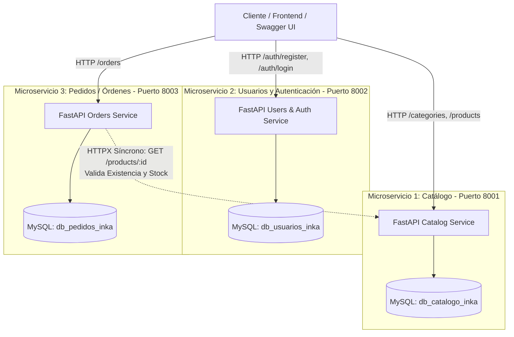

# Sistema de E-Commerce Farmacéutico (Estilo Inkafarma)
## Arquitectura de Microservicios con FastAPI, SQLAlchemy y MySQL

Este proyecto académico implementa un sistema distribuido de comercio electrónico farmacéutico bajo el patrón de diseño **Database-per-Service** (una base de datos independiente por cada microservicio).

---

## 🏛️ Arquitectura del Sistema



---

## ⚠️ Evaluación del Comando de Python en su Sistema

> [!IMPORTANT]
> Se verificó el entorno de su sistema operativo Windows y se identificó lo siguiente:
> - El comando `python` apunta a **Python 2.7.15** (`C:\BioTime\Python27\python.exe`).
> - El comando `python3` apunta a **Python 3.13.14** (`C:\Users\...\python3.exe`).
> - Por lo tanto, su intuición fue **100% correcta**: **DEBE utilizar `python3`** (o el intérprete de su entorno virtual) para ejecutar todos los comandos del proyecto. Si usa `python` por error, el sistema ejecutará la versión obsoleta 2.7 y fallará.

---

## 📂 Estructura de Directorios

```text
app_microservicios/
│
├── init_db.sql                     # Script SQL para crear las 3 bases de datos en MySQL
├── seed_data.sql                   # Datos de prueba opcionales (categorías, medicamentos, stock)
├── requirements.txt                # Dependencias unificadas de Python
├── README.md                       # Documentación académica completa
│
├── catalog_service/                # MICROSERVICIO 1: Catálogo (Puerto 8001)
│   ├── .env.example                # Plantilla de variables de entorno
│   ├── .env                        # Configuración local (db_catalogo_inka)
│   ├── database.py                 # Conexión SQLAlchemy y generador get_db()
│   ├── models.py                   # Modelos Category y Product
│   ├── schemas.py                  # Esquemas Pydantic v2
│   ├── main.py                     # API FastAPI y Endpoints Swagger
│   ├── alembic.ini                 # Configuración de migraciones Alembic
│   └── alembic/                    # Entorno y versiones de migración
│       ├── env.py
│       ├── script.py.mako
│       └── versions/
│           └── 001_initial_catalog.py
│
├── users_service/                  # MICROSERVICIO 2: Usuarios y Autenticación (Puerto 8002)
│   ├── .env.example
│   ├── .env                        # Configuración local (db_usuarios_inka)
│   ├── database.py                 # Conexión SQLAlchemy
│   ├── models.py                   # Modelo User
│   ├── security.py                 # Hasheo con Bcrypt y generación de tokens JWT
│   ├── schemas.py                  # Esquemas Pydantic para registro y login
│   ├── main.py                     # API FastAPI y Endpoints de autenticación
│   ├── alembic.ini
│   └── alembic/
│       ├── env.py
│       ├── script.py.mako
│       └── versions/
│           └── 001_initial_users.py
│
└── orders_service/                 # MICROSERVICIO 3: Pedidos / Órdenes (Puerto 8003)
    ├── .env.example
    ├── .env                        # Configuración local (db_pedidos_inka)
    ├── database.py                 # Conexión SQLAlchemy
    ├── models.py                   # Modelos Order y OrderItem
    ├── client.py                   # Cliente HTTP síncrono con HTTPX hacia Catálogo (8001)
    ├── schemas.py                  # Esquemas Pydantic de órdenes
    ├── main.py                     # API FastAPI y lógica de validación de pedidos
    ├── alembic.ini
    └── alembic/
        ├── env.py
        ├── script.py.mako
        └── versions/
            └── 001_initial_orders.py
```

---

## 🛠️ Paso 1: Instalación del Entorno Virtual y Dependencias

Abra una terminal de PowerShell en la raíz del proyecto (`app_microservicios`):

```powershell
# 1. Crear el entorno virtual con Python 3
python3 -m venv venv

# 2. Activar el entorno virtual en Windows PowerShell
.\venv\Scripts\Activate.ps1

# (Si PowerShell bloquea la ejecución de scripts, ejecute primero:
# Set-ExecutionPolicy -Scope Process -ExecutionPolicy Bypass)

# 3. Instalar todas las dependencias requeridas
python3 -m pip install --upgrade pip
python3 -m pip install -r requirements.txt
```

---

## 🗄️ Paso 2: Creación de las Bases de Datos en MySQL

Asegúrese de que su servidor MySQL esté activo (por ejemplo, a través del panel de **XAMPP**, **MySQL Workbench**, servicio de Windows o consola).

### Opción A: Desde MySQL CLI / Consola
```powershell
# Iniciar sesión en MySQL y ejecutar el script init_db.sql
mysql -u root -p < init_db.sql
```

### Opción B: Desde MySQL Workbench o phpMyAdmin
Abra el archivo [`init_db.sql`](file:///c:/Users/willd/OneDrive/Desktop/workspace/app_microservicios/init_db.sql) y ejecute su contenido:
```sql
CREATE DATABASE IF NOT EXISTS `db_catalogo_inka` CHARACTER SET utf8mb4 COLLATE utf8mb4_unicode_ci;
CREATE DATABASE IF NOT EXISTS `db_usuarios_inka` CHARACTER SET utf8mb4 COLLATE utf8mb4_unicode_ci;
CREATE DATABASE IF NOT EXISTS `db_pedidos_inka` CHARACTER SET utf8mb4 COLLATE utf8mb4_unicode_ci;
```

---

## 🔄 Paso 3: Ejecución de Migraciones con Alembic

Cada microservicio gestiona su propio esquema de base de datos de manera desacoplada:

```powershell
# 1. Aplicar migraciones en Microservicio de Catálogo (db_catalogo_inka)
cd catalog_service
python3 -m alembic upgrade head
cd ..

# 2. Aplicar migraciones en Microservicio de Usuarios (db_usuarios_inka)
cd users_service
python3 -m alembic upgrade head
cd ..

# 3. Aplicar migraciones en Microservicio de Pedidos (db_pedidos_inka)
cd orders_service
python3 -m alembic upgrade head
cd ..
```

*(Opcional para pruebas rápidas)*: Puede ejecutar [`seed_data.sql`](file:///c:/Users/willd/OneDrive/Desktop/workspace/app_microservicios/seed_data.sql) en MySQL para precargar categorías y medicamentos con stock.

---

## 🚀 Paso 4: Levantar los 3 Microservicios con Uvicorn

Abra **tres pestañas o ventanas de terminal separadas** (todas con el entorno virtual activado):

### 🟢 Terminal 1 - Microservicio de Catálogo (Puerto 8001)
```powershell
cd catalog_service
python3 -m uvicorn main:app --host 127.0.0.1 --port 8001 --reload
```
- **Documentación Swagger:** [http://127.0.0.1:8001/docs](http://127.0.0.1:8001/docs)

### 🔵 Terminal 2 - Microservicio de Usuarios y Autenticación (Puerto 8002)
```powershell
cd users_service
python3 -m uvicorn main:app --host 127.0.0.1 --port 8002 --reload
```
- **Documentación Swagger:** [http://127.0.0.1:8002/docs](http://127.0.0.1:8002/docs)

### 🟠 Terminal 3 - Microservicio de Pedidos / Órdenes (Puerto 8003)
```powershell
cd orders_service
python3 -m uvicorn main:app --host 127.0.0.1 --port 8003 --reload
```
- **Documentación Swagger:** [http://127.0.0.1:8003/docs](http://127.0.0.1:8003/docs)

---

## 🧪 Demostración Académica y Pruebas del Flujo Inter-servicio

A continuación se detalla la secuencia recomendada para sustentar o presentar el funcionamiento del sistema:

### 1. Registrar una Categoría y un Producto (Puerto 8001)
- Ir a [http://127.0.0.1:8001/docs](http://127.0.0.1:8001/docs)
- **POST `/categories/`**:
  ```json
  {
    "name": "Analgésicos y Alivio",
    "description": "Medicamentos para control del dolor y la fiebre"
  }
  ```
- **POST `/products/`**:
  ```json
  {
    "name": "Paracetamol 500mg - Caja 20 tabletas",
    "description": "Alivio temporal de dolores leves a moderados",
    "price": 8.50,
    "stock": 50,
    "category_id": 1
  }
  ```
  *(Devolverá el producto creado con `id: 1` y `stock: 50`)*.

---

### 2. Registrar un Usuario y Autenticarse (Puerto 8002)
- Ir a [http://127.0.0.1:8002/docs](http://127.0.0.1:8002/docs)
- **POST `/auth/register`**:
  ```json
  {
    "full_name": "Carlos Gomez",
    "email": "carlos.gomez@gmail.com",
    "password": "miPasswordSeguro123",
    "address": "Av. Larco 1234, Miraflores, Lima",
    "phone": "+51 912345678"
  }
  ```
- **POST `/auth/login`**:
  ```json
  {
    "email": "carlos.gomez@gmail.com",
    "password": "miPasswordSeguro123"
  }
  ```
  *(Devolverá el token JWT firmado `access_token` y los datos del usuario)*.

---

### 3. Crear una Orden de Compra (Puerto 8003 - Inter-Service Call)
- Ir a [http://127.0.0.1:8003/docs](http://127.0.0.1:8003/docs)
- **POST `/orders/`**:
  ```json
  {
    "user_id": 1,
    "items": [
      {
        "product_id": 1,
        "quantity": 3
      }
    ]
  }
  ```
  **Comportamiento interno:**
  - El Microservicio de Órdenes utiliza `httpx` para llamar a `http://localhost:8001/products/1`.
  - Verifica que el producto exista y que el `stock` (50) sea mayor o igual a la cantidad solicitada (3).
  - Calcula automáticamente el monto total: `3 * 8.50 = 25.50`.
  - Guarda la orden con estado `COMPLETED` en la base de datos `db_pedidos_inka`.

---

### 4. Prueba de Casos Borde (Validaciones de Microservicio)
- **Caso A (Stock Insuficiente):** Envíe `quantity: 999`.
  - **Respuesta:** `HTTP 400 Bad Request` con mensaje detallado:
    `"Insufficient stock for product 'Paracetamol 500mg - Caja 20 tabletas' (ID 1). Available stock: 50, Requested quantity: 999."`
- **Caso B (Producto Inexistente):** Envíe `product_id: 9999`.
  - **Respuesta:** `HTTP 404 Not Found`:
    `"Product with ID 9999 does not exist in the catalog."`
- **Caso C (Servicio de Catálogo Apagado):** Si detiene el servicio en el puerto 8001 e intenta crear una orden:
  - **Respuesta:** `HTTP 503 Service Unavailable` con mensaje controlado:
    `"Catalog Service is unreachable at http://localhost:8001. Ensure the service is running on port 8001."`

---

## 📝 Convenciones de Código
- **Código Fuente (Variables, Clases, Funciones, Endpoints):** Estrictamente en **INGLÉS** según estándares de la industria.
- **Comentarios y Docstrings:** Detallados y pedagógicos en **ESPAÑOL** para sustentación académica.
- **Arquitectura:** Totalmente desacoplada bajo el estándar **Database-per-Service**.
