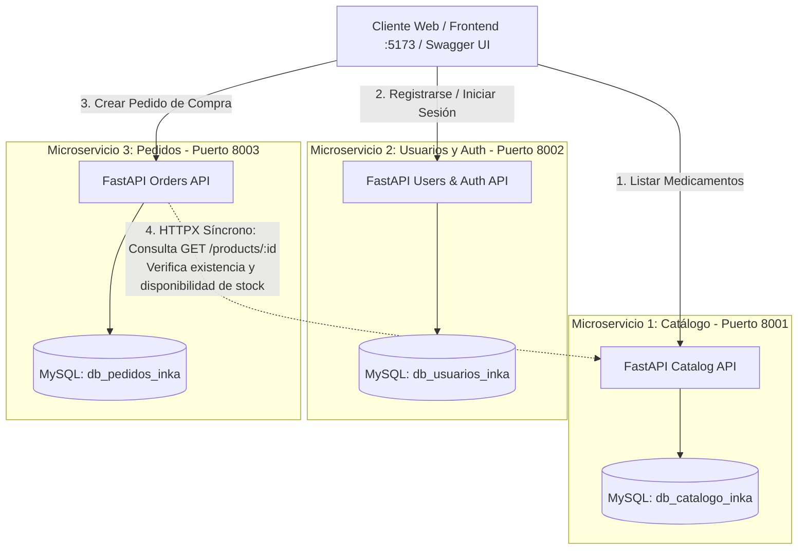

# Sistema de Comercio Electrónico Farmacéutico
## Arquitectura de Microservicios con FastAPI, SQLAlchemy, MySQL y React

Este proyecto académico implementa un sistema distribuido de comercio electrónico para una cadena farmacéutica, diseñado bajo el patrón arquitectónico **Database-per-Service** (cada microservicio cuenta con su propio esquema de base de datos aislado e independiente).

---

## 🎯 Objetivo y Funcionamiento del Sistema

El propósito de este proyecto es simular el ciclo completo de una tienda farmacéutica en línea (catálogo de medicamentos, registro y autenticación de clientes, y procesamiento seguro de pedidos con validación de inventario en tiempo real).

A diferencia de una aplicación monolítica tradicional donde todo comparte una única base de datos, aquí el sistema se divide en **3 servicios backend autónomos** que se comunican mediante peticiones HTTP, complementados por un **Frontend moderno en React y Tailwind CSS**:



---

## 🧩 Detalle de Módulos y Lógica Interna

Para facilitar la comprensión del equipo y la sustentación académica, a continuación se describe qué función cumple cada microservicio y cómo interactúan entre sí:

### 1. Microservicio de Catálogo (`catalog_service` - Puerto 8001)
- **Propósito:** Administrar el inventario farmacéutico, las familias o categorías de medicamentos y los precios vigentes.
- **Base de Datos Exclusiva:** `db_catalogo_inka`.
- **Modelos ORM:**
  - `Category`: Identificador, nombre de la categoría (ej. *Analgésicos*, *Cuidado Personal*, *Vitaminas*) y descripción.
  - `Product`: Identificador, nombre comercial y presentación (ej. *Paracetamol 500mg - Caja 20 tabletas*), descripción médica, precio unitario, stock disponible y categoría referenciada.
- **Endpoints Clave:**
  - `POST /categories/`: Creación de nuevas categorías.
  - `GET /categories/`: Listado completo de categorías para navegación.
  - `POST /products/`: Ingreso de nuevos medicamentos al catálogo.
  - `GET /products/`: Listado paginado de productos para la tienda virtual.
  - `GET /products/{id}`: **Endpoint fundamental para otros microservicios**. Es el canal por el cual el microservicio de pedidos consulta el stock y precio oficial de un producto sin acceder a la base de datos de catálogo directamente.

---

### 2. Microservicio de Usuarios y Autenticación (`users_service` - Puerto 8002)
- **Propósito:** Gestionar el registro de clientes, la seguridad de las cuentas y la emisión de tokens de sesión.
- **Base de Datos Exclusiva:** `db_usuarios_inka`.
- **Modelo ORM:**
  - `User`: ID, nombre completo, email único, hash de contraseña, dirección de entrega y teléfono de contacto.
- **Lógica de Seguridad Interna:**
  - **Encriptación Unidireccional con Bcrypt:** Las contraseñas nunca se guardan en texto plano; se procesan mediante un algoritmo de hashing con salt antes de persistirlas.
  - **JSON Web Tokens (JWT):** Al iniciar sesión correctamente, el servicio genera un token firmado (HMAC-SHA256) con expiración configurable que autentica la identidad del usuario ante el sistema.
- **Endpoints Clave:**
  - `POST /auth/register`: Registro de nuevos clientes con hasheo automático de contraseña.
  - `POST /auth/login`: Validación de credenciales y generación del token JWT.
  - `GET /users/{id}`: Consulta de datos de cliente para despacho y facturación.

---

### 3. Microservicio de Pedidos / Órdenes (`orders_service` - Puerto 8003)
- **Propósito:** Recibir y procesar los pedidos de compra de los clientes, garantizando la consistencia del negocio antes de asentar una venta.
- **Base de Datos Exclusiva:** `db_pedidos_inka`.
- **Modelos ORM:**
  - `Order`: ID, usuario ID, monto total liquidado, estado (`PENDING`, `COMPLETED`, `CANCELLED`) y fecha de creación.
  - `OrderItem`: ID, orden ID, producto ID, cantidad solicitada y precio unitario congelado al momento de la compra.
- **Comunicación Inter-servicio Síncrona con HTTPX:**
  - Cuando el cliente envía una solicitud para crear un pedido (`POST /orders/`), este microservicio no puede leer la tabla de productos porque pertenece a otra base de datos.
  - Por ello, utiliza el cliente HTTP **`HTTPX`** para consultar en tiempo real al Microservicio de Catálogo:
    `GET http://localhost:8001/products/{product_id}`
  - **Reglas de Negocio Validadas:**
    1. **Existencia:** Si el producto no existe en el catálogo, el pedido se rechaza con `HTTP 404 Not Found`.
    2. **Stock Suficiente:** Si el cliente solicita más unidades de las que hay en stock, el pedido se rechaza con `HTTP 400 Bad Request`, indicando el stock disponible real.
    3. **Cálculo de Monto Total:** Si todos los medicamentos son válidos, se calcula el importe sumando `cantidad * precio_unitario` y se persiste la orden con estado `COMPLETED`.
    4. **Tolerancia a Fallos:** Si el servicio de catálogo se encuentra apagado, el servicio captura la excepción y retorna un mensaje controlado `HTTP 503 Service Unavailable`.
- **Endpoints Clave:**
  - `POST /orders/`: Recepción de la orden, validación con el catálogo y asentamiento en base de datos.
  - `GET /orders/{id}`: Consulta de detalles y estado de una orden específica.
  - `GET /orders/`: Listado histórico de pedidos.

---

### 4. Aplicación Frontend (`frontend` - Puerto 5173)
- **Propósito:** Tienda virtual farmacéutica construida con **React, Vite y Tailwind CSS v3**.
- **Funcionalidades:**
  - Catálogo de productos con filtros por categoría y buscador dinámico.
  - Indicadores de stock con alertas (*"En stock"*, *"Últimas unidades"*, *"Agotado"*).
  - Modal de autenticación con inicio de sesión y registro de clientes.
  - Carrito de compras deslizante que consume el microservicio de órdenes y muestra la confirmación de la transacción en tiempo real.
  - Monitor en vivo que muestra con indicadores verdes/rojos el estado de salud de los 3 microservicios backend.

---

## 💻 Requisitos del Sistema

Para ejecutar este proyecto se requiere contar con las siguientes herramientas instaladas:

- **Python 3.10 o superior** (probado y compatible hasta Python 3.13)
- **MySQL Server 8.0+** o MariaDB (puede usarse XAMPP, MySQL Workbench, Docker o servicio local)
- **Node.js 18+** y **npm** (para levantar la aplicación frontend)
- **Git** (para control de versiones)

Verifique sus versiones ejecutando en consola:
```powershell
python --version   # O python3 --version dependiendo de su configuración
mysql --version
node -v
```

---

## 📂 Estructura del Repositorio

```text
app_microservicios/
│
├── init_db.sql                     # Script SQL para crear las 3 bases de datos en MySQL
├── seed_data.sql                   # Datos de prueba iniciales (medicamentos, categorías, stock)
├── requirements.txt                # Dependencias de Python (FastAPI, SQLAlchemy, Alembic, etc.)
├── README.md                       # Documentación principal del sistema
├── instructions.md                 # Guía paso a paso de comandos de instalación y ejecución
│
├── catalog_service/                # MICROSERVICIO 1: Catálogo (Puerto 8001)
│   ├── .env.example                # Plantilla de variables de entorno (db_catalogo_inka)
│   ├── database.py                 # Conexión SQLAlchemy y generador get_db()
│   ├── models.py                   # Modelos Category y Product
│   ├── schemas.py                  # Esquemas de validación Pydantic
│   ├── main.py                     # API FastAPI y Endpoints Swagger
│   ├── alembic.ini                 # Configuración de migraciones
│   └── alembic/                    # Historial de versiones de migración
│
├── users_service/                  # MICROSERVICIO 2: Usuarios y Autenticación (Puerto 8002)
│   ├── .env.example                # Plantilla de variables de entorno (db_usuarios_inka)
│   ├── database.py                 # Conexión SQLAlchemy
│   ├── models.py                   # Modelo User
│   ├── security.py                 # Hashing Bcrypt y generación de tokens JWT
│   ├── schemas.py                  # Esquemas Pydantic para registro y login
│   ├── main.py                     # API FastAPI y Endpoints de autenticación
│   ├── alembic.ini
│   └── alembic/
│
├── orders_service/                 # MICROSERVICIO 3: Pedidos / Órdenes (Puerto 8003)
│   ├── .env.example                # Plantilla de variables de entorno (db_pedidos_inka)
│   ├── database.py                 # Conexión SQLAlchemy
│   ├── models.py                   # Modelos Order y OrderItem
│   ├── client.py                   # Cliente HTTP síncrono (HTTPX) hacia Catálogo (:8001)
│   ├── schemas.py                  # Esquemas Pydantic de pedidos
│   ├── main.py                     # API FastAPI y lógica de validación de órdenes
│   ├── alembic.ini
│   └── alembic/
│
├── frontend/                       # APLICACIÓN CLIENTE WEB (Puerto 5173)
│   ├── src/                        # Código fuente React + Tailwind CSS v3
│   ├── package.json                # Dependencias Node.js
│   └── vite.config.js              # Configuración de empaquetado Vite
│
└── Scripts de Lanzamiento Rápido:
    ├── run_all.bat / run_all.ps1       # Levanta los 3 microservicios y el frontend con un solo clic
    ├── run_catalog.bat / .ps1          # Levanta únicamente el Catálogo (:8001)
    ├── run_users.bat / .ps1            # Levanta únicamente Usuarios (:8002)
    ├── run_orders.bat / .ps1           # Levanta únicamente Pedidos (:8003)
    └── run_frontend.bat                # Levanta el servidor web del Frontend (:5173)
```

---

## 🚀 Guía de Instalación y Ejecución

### 1. Configuración de Base de Datos en MySQL
Asegúrese de que su servidor MySQL esté en ejecución. Ejecute los siguientes scripts:

1. [`init_db.sql`](file:///c:/Users/willd/OneDrive/Desktop/workspace/app_microservicios/init_db.sql): Crea las tres bases de datos (`db_catalogo_inka`, `db_usuarios_inka`, `db_pedidos_inka`).
2. [`seed_data.sql`](file:///c:/Users/willd/OneDrive/Desktop/workspace/app_microservicios/seed_data.sql): Inserta categorías de ejemplo, medicamentos con stock y un usuario de prueba.

### 2. Entorno Virtual de Python y Dependencias
En la raíz del proyecto (`app_microservicios`):

```powershell
# Crear entorno virtual
python -m venv venv   # O use python3 según corresponda en su sistema

# Activar entorno virtual en Windows PowerShell
.\venv\Scripts\Activate.ps1

# Instalar librerías requeridas
pip install -r requirements.txt
```

### 3. Variables de Entorno (.env)
Cada microservicio cuenta con un archivo `.env` configurado. Si su usuario o contraseña de MySQL son diferentes a los predeterminados (`root` / `1234`), modifíquelos en:
- `catalog_service/.env`
- `users_service/.env`
- `orders_service/.env`

---

## ⚡ Cómo Iniciar el Sistema Completo

### Opción Rápida (1 solo clic)
Estando en la carpeta raíz del proyecto, ejecute:

```powershell
.\run_all.bat
```
*(O haga doble clic en el archivo `run_all.bat` desde el Explorador de Windows).*

Este script abrirá 4 terminales independientes:
- **Catálogo:** [http://127.0.0.1:8001/docs](http://127.0.0.1:8001/docs)
- **Usuarios:** [http://127.0.0.1:8002/docs](http://127.0.0.1:8002/docs)
- **Pedidos:** [http://127.0.0.1:8003/docs](http://127.0.0.1:8003/docs)
- **Frontend Web:** [http://localhost:5173](http://localhost:5173)

---

## 🧪 Demostración y Pruebas del Flujo Inter-servicio

Para sustentar académicamente el funcionamiento de la arquitectura:

1. **Abra el Frontend Web:** Ingrese a [http://localhost:5173](http://localhost:5173).
2. **Observe la barra superior:** Verifique que los tres indicadores de estado de los microservicios (:8001, :8002, :8003) estén en color verde.
3. **Inicie sesión:** Haga clic en *"Iniciar Sesión"* y utilice el botón de prueba para autenticar al usuario (el servicio en el puerto 8002 validará las credenciales y emitirá el JWT).
4. **Agregue medicamentos al carrito:** Seleccione la cantidad deseada de medicamentos cargados desde el catálogo (:8001).
5. **Procese la compra:** Abra el carrito y haga clic en *"Procesar Orden de Compra"*.
   - El microservicio de pedidos (:8003) llamará síncronamente vía HTTPX al microservicio de catálogo (:8001) para certificar stock.
   - Si es exitoso, la orden quedará asentada y se mostrará la ventana con el código de confirmación.
6. **Pruebe las validaciones de fallo:** Intente ordenar una cantidad superior al stock visible; observará que el sistema bloquea la transacción informando el stock disponible real.
