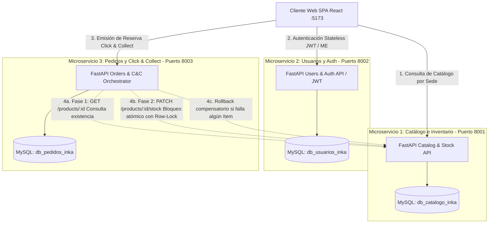

# Plataforma Omnicanal Click & Collect (Inkafarma)
## Evolución hacia una Arquitectura Orientada a Servicios (SOA) y Microservicios
### FastAPI, SQLAlchemy, MySQL y React (Tailwind CSS)

Este proyecto implementa una solución de **Comercio Omnicanal Click & Collect** bajo el patrón arquitectónico **Database-per-Service**, donde cada microservicio gestiona su propio esquema de base de datos de forma desacoplada e independiente.

El objetivo central del sistema es **eliminar la fricción de pasarelas bancarias virtuales** y **erradicar los quiebres de stock** mediante reservas digitales inmediatas con **bloqueo atómico de inventario en tiempo real**, emisión de tickets alfanuméricos de recojo y liquidación presencial en la caja física de la botica (Efectivo o POS).

---

## 🎯 Visión General de la Arquitectura (TO-BE)



---

## 🧩 Arquitectura de Módulos y Lógica de Negocio

### 1. Microservicio de Catálogo e Inventario (`catalog_service` - Puerto 8001)
- **Responsabilidad:** Administrar el inventario físico por sede farmacéutica y ejecutar el bloqueo atómico transaccional de stock.
- **Base de Datos:** `db_catalogo_inka`.
- **Modelos ORM:**
  - `Category`: Identificador, nombre de la categoría (ej. *Medicamentos y Alivio del Dolor*, *Cuidado Personal*, *Vitaminas*) y descripción.
  - `Product`: Identificador, nombre comercial, descripción médica, precio unitario, stock disponible en botica, sede asignada (`branch`) y referencia a la categoría.
- **Endpoints Clave:**
  - `GET /products/` o `/api/v1/products`: Catálogo paginado con filtros por categoría.
  - `GET /products/{id}` o `/api/v1/products/{id}`: Ficha técnica, precio y existencias.
  - `PATCH /products/{id}/stock` o `/api/v1/products/{id}/stock`: **Bloqueo o reposición atómica de inventario** mediante bloqueo de fila (`SELECT ... FOR UPDATE`) para prevenir sobreventas concurrentes.

---

### 2. Microservicio de Usuarios y Autenticación (`users_service` - Puerto 8002)
- **Responsabilidad:** Registro, autenticación segura y emisión de credenciales stateless (JWT) para trazabilidad de reservas.
- **Base de Datos:** `db_usuarios_inka`.
- **Seguridad:**
  - **Hashing con Bcrypt:** Almacenamiento seguro unidireccional con salt aleatorio.
  - **JSON Web Tokens (JWT):** Generación y validación de tokens de acceso Bearer.
- **Endpoints Clave:**
  - `POST /auth/register` o `/api/v1/auth/register`: Registro de nuevos clientes.
  - `POST /auth/login` o `/api/v1/auth/login`: Autenticación y retorno de token JWT.
  - `GET /auth/me` o `/api/v1/auth/me`: Claims y perfil del cliente autenticado vía Bearer Token.

---

### 3. Microservicio de Pedidos y Orquestador Click & Collect (`orders_service` - Puerto 8003)
- **Responsabilidad:** Orquestador de la reserva digital, emisión de tickets de recojo y gestión transaccional con tolerancia a fallos.
- **Base de Datos:** `db_pedidos_inka`.
- **Modelos ORM:**
  - `Order`: ID, código único de recojo (`pickup_code` alfanumérico ej. `INKA-CC-7F3A9`), usuario ID, monto total liquidable en botica, sede de retiro (`branch`), modalidad (`PAGO_EN_CAJA_PRESENCIAL`), estado (`RESERVED`, `COLLECTED`, `CANCELLED`) y fecha de creación.
  - `OrderItem`: ID, orden ID, producto ID, cantidad solicitada y precio unitario congelado.
- **Orquestación en 2 Fases y Compensación (Saga Ligera):**
  1. **Fase 1 (Validación):** Consulta existencia y precios en `catalog_service`.
  2. **Fase 2 (Bloqueo Atómico):** Invoca `PATCH /products/{id}/stock` con `action="block"`.
  3. **Compensación (Rollback):** Si un producto falla por falta de stock o timeout, se invoca `PATCH /products/{id}/stock` con `action="release"` para liberar inmediatamente los productos previamente bloqueados.
- **Endpoints Clave:**
  - `POST /orders/` o `/api/v1/orders`: Orquestación y emisión de la reserva con código de recojo.
  - `GET /orders/{id}`: Estado transaccional del ticket (utilizado por el personal de mostrador en botica).
  - `GET /orders/user/{user_id}`: Historial de reservas emitidas por cliente.
  - `PATCH /orders/{id}/collect`: Cobro presencial en caja (Efectivo/POS) y entrega de medicamentos.
  - `PATCH /orders/{id}/cancel`: Cancelación con reposición automática de stock en Catálogo.

---

### 4. Cliente Web Frontend (`frontend` - Puerto 5173)
- **Tecnología:** React + Vite + Tailwind CSS v3.
- **Componentes y Capacidades:**
  - Vista de productos con filtrado reactivo por categorías y búsqueda por texto.
  - Indicadores de stock en tiempo real (*"En stock"*, *"Últimas unidades"*, *"Agotado"*).
  - Modal de autenticación para login y registro de clientes con almacenamiento seguro de tokens.
  - Carrito de compras deslizante con integración directa hacia el endpoint de órdenes.
  - Panel superior con monitoreo de disponibilidad para los 3 puertos backend.

---

## 💻 Requisitos del Sistema

- **Python 3.10+** (compatible con 3.11, 3.12 y 3.13)
- **MySQL Server 8.0+** o MariaDB
- **Node.js 18+** y **npm**
- **Git**

Comandos de verificación:
```powershell
python --version   # O python3 según la configuración del sistema
mysql --version
node -v
```

---

## 📂 Estructura del Repositorio

```text
app_microservicios/
│
├── init_db.sql                     # Script para creación de las 3 bases de datos en MySQL
├── seed_data.sql                   # Datos iniciales de prueba (categorías, productos, usuario)
├── requirements.txt                # Dependencias Python del backend
├── README.md                       # Especificación técnica del proyecto
├── instructions.md                 # Guía de instalación y comandos
│
├── catalog_service/                # Servicio de Catálogo (Puerto 8001)
│   ├── .env.example
│   ├── database.py
│   ├── models.py
│   ├── schemas.py
│   ├── main.py
│   └── alembic/
│
├── users_service/                  # Servicio de Usuarios y Auth (Puerto 8002)
│   ├── .env.example
│   ├── database.py
│   ├── models.py
│   ├── security.py
│   ├── schemas.py
│   ├── main.py
│   └── alembic/
│
├── orders_service/                 # Servicio de Pedidos (Puerto 8003)
│   ├── .env.example
│   ├── database.py
│   ├── models.py
│   ├── client.py                   # Cliente HTTPX para comunicación con Catálogo
│   ├── schemas.py
│   ├── main.py
│   └── alembic/
│
├── frontend/                       # Cliente Web React (Puerto 5173)
│   ├── src/
│   ├── package.json
│   └── vite.config.js
│
└── Scripts de Ejecución:
    ├── run_all.bat / run_all.ps1       # Levanta todos los servicios concurrentemente
    ├── run_catalog.bat / .ps1          # Levanta Catálogo (:8001)
    ├── run_users.bat / .ps1            # Levanta Usuarios (:8002)
    ├── run_orders.bat / .ps1           # Levanta Pedidos (:8003)
    └── run_frontend.bat                # Levanta Frontend (:5173)
```

---

## 🚀 Puesta en Marcha

### 1. Configuración de Base de Datos
Ejecutar en MySQL los scripts de preparación:
1. [`init_db.sql`](file:///c:/Users/willd/OneDrive/Desktop/workspace/app_microservicios/init_db.sql): Genera los esquemas `db_catalogo_inka`, `db_usuarios_inka` y `db_pedidos_inka`.
2. [`seed_data.sql`](file:///c:/Users/willd/OneDrive/Desktop/workspace/app_microservicios/seed_data.sql): Carga categorías, medicamentos con stock inicial y un usuario de prueba.

### 2. Entorno Virtual de Python
Desde la raíz del proyecto (`app_microservicios`):
```powershell
python -m venv venv
.\venv\Scripts\Activate.ps1
pip install -r requirements.txt
```

### 3. Variables de Entorno (.env)
Asegurar que los archivos `.env` de cada microservicio contengan las credenciales correctas de MySQL (`root` / `1234` por defecto):
- `catalog_service/.env`
- `users_service/.env`
- `orders_service/.env`

---

## ⚡ Ejecución del Sistema

### Modo Automatizado
Para levantar los tres microservicios y el cliente web en terminales independientes:
```powershell
.\run_all.bat
```

Servicios disponibles:
- **Catálogo API:** [http://127.0.0.1:8001/docs](http://127.0.0.1:8001/docs)
- **Usuarios API:** [http://127.0.0.1:8002/docs](http://127.0.0.1:8002/docs)
- **Pedidos API:** [http://127.0.0.1:8003/docs](http://127.0.0.1:8003/docs)
- **Cliente Web:** [http://localhost:5173](http://localhost:5173)

---

## 🧪 Flujo de Validación Inter-servicio

Para verificar la integración entre componentes:

1. **Acceder a la Interfaz Web:** [http://localhost:5173](http://localhost:5173).
2. **Verificar Estado:** Los indicadores del encabezado deben figurar activos en verde para los tres microservicios.
3. **Autenticación:** Iniciar sesión con un usuario registrado (el servicio `:8002` valida la contraseña contra su hash y retorna el JWT).
4. **Selección de Productos:** Agregar medicamentos del catálogo (`:8001`) al carrito de compra.
5. **Confirmación de Orden:** Procesar la compra desde el carrito.
   - El servicio `:8003` consulta síncronamente a `:8001` mediante HTTPX para validar stock.
   - Confirmada la disponibilidad, se emite el identificador de orden y se actualiza el inventario.
6. **Manejo de Errores:** Al solicitar cantidades superiores al stock disponible, el servicio de pedidos bloquea la transacción y retorna el detalle del error (`HTTP 400`).
